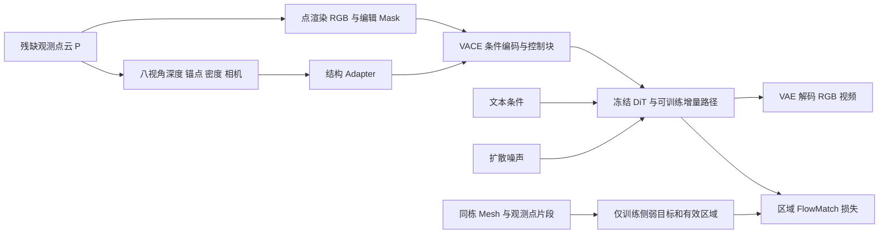

# 建筑与点云补全项目全景 代码结构与当前困难

整理日期：2026年11月15日，UTC+09:00。供其他 AI 或研究合作者分析下一步研究方向。

本项目先研究灰色建筑环绕视频生成，随后研究 BuildingFiller 残缺建筑的 VACE 视频补全，现在的重点是把天然残缺建筑点云补完整，并保持原始观测、离散点外观和多视角几何一致性。最新完成的工作是为全部 15,890 个 OBJ 准备完整几何点云 GT，并核查它们与 15,881 份实测残缺点云的建筑编号及坐标关系。

**当前已经跑通视频补全和点云结构条件微调，但还没有完成一个可靠的“残缺实测点云输入 → 完整三维点云输出”系统。** D-3000 模型输出 RGB 视频，不输出 XYZ、法向或跨帧点 ID；独立的固定三维补点方法输出过真实点集，但覆盖不足。新的完整几何 GT 已就绪，尚未接入新的正式训练。

这份报告把“实际做过什么”“现有代码如何工作”“当前缺什么”“哪些原因只是猜测”分开说明。历史实验数字来自既有正式报告；2026-11-15 另外核对了现存目录、源码、Python 环境、两份 D 最终权重的哈希及 Git 状态。未重新训练、推理或播放视频，未重新计算历史质量指标，也没有将报告发送给外部 AI。报告中关于视觉的描述沿用已完成的静态复核，不扩大为新的视觉验收。

项目根目录为 `/mnt/windowsE/chuanjun/building_wan`。下文代码树及表中的相对路径均以此为根；正文直接写出理解问题所需的参数和数字，单独复制本文件也可以阅读。媒体和权重不随报告附带。

## 1 当前目标与需要先作出的研究决策

### 1.1 项目实际希望解决的问题

输入是一栋建筑的实测残缺点云，通常具有颜色，屋顶、墙面、檐口或扫描条带存在缺失。希望利用已有观测和建筑结构先验恢复缺失部分，并满足以下要求：

1. 已有观测点的位置和颜色应保留，不能为了补洞重画整栋建筑。
2. 新增点应落在合理的墙面、屋面和连接位置，不能只是视觉上遮住缺口。
3. 点应呈现稀疏、可分辨的实测点风格，背景能从点之间透出，避免黑底点阵或实体面片。
4. 同一三维点在不同相机下应保持固定，绕建筑一圈不能变形、跳面或首尾不一致。
5. 最终若用于三维补全，需要明确可交付的 XYZ 点集及评价方式；只有看起来像点云的视频不满足这一要求。

第5项是下一步路线讨论必须明确的输出契约。现有研究同时尝试了“先生成视频”和“先确定三维点再渲染”，两条路线目前各有缺陷，尚未形成最终选择。

### 1.2 三个历史阶段不能混用

| 阶段 | 输入与任务 | 已有输出 | 与当前点云任务的关系 |
| --- | --- | --- | --- |
| 历史 T2V | 统一文本提示，学习灰色建筑外观和环绕生成 | Wan2.1-T2V-1.3B LoRA、比较视频 | 不是残缺条件补全，旧缓存和权重不能直接当当前训练起点 |
| BuildingFiller VACE | Damaged 图像序列、Exact 缺损掩码、文本 | 灰色建筑补全视频及各组 VACE LoRA | 证明小规模微调能改善视频补洞，但未证明真实点云补全 |
| 当前 pointcloud_vace | 实测残缺 PLY/XYZ、渲染视频、mask、相机及结构条件 | D Adapter/LoRA、点云外观视频、三栋固定点实验；最新几何 GT | 当前研究主线，主要瓶颈是监督、输出表示、几何覆盖和评价 |

早期building_v1按source_obj分组，训练/验证/测试为1912/239/239、seed20260902；后来的单轨统一prompt为1992/234/118、seed20260924。两套划分不能合并。逐栋prompt或Cap3D文本也不能混入当前VACE训练，统一prompt的共享文本缓存只适用于对应历史实验。

### 1.3 当前状态一览

| 项目 | 当前真实状态 |
| --- | --- |
| BuildingFiller 各组 | Pilot8、Complex12 Rev1、OriginalHard、C_mix、Orbit17 均已完成既定计算与相应报告 |
| 点云原版 VACE | 0号 V2/V3 各完成一次81帧推理，仍出现密集点阵面片和首尾差异 |
| 点云 D 组 | 八视角结构 Adapter 与 VACE attention LoRA，共3000次真实更新完成 |
| D 八栋开发评测 | 8条81帧、16条原始/对比视频完成；已有三栋后续静态问题复核，其余五栋不能写成人工验收通过 |
| 固定三维补点 | 三栋 CPU 实验完成，几何固定带来闭环一致，但漏补和候选定位问题明显 |
| 单张参考图 V2 | 一栋、A/B/C各两个seed，共六条17帧推理完成；效果结论仍待专门视觉复核 |
| 全量几何 GT | 15,890个OBJ对应的16,384点/栋 GT 已完成；上传后stable版本已做全量格式/坐标元数据审查 |
| 新 GT 训练 | 当前自有训练代码未接入stable GT和偏移表，未启动新一轮GT监督训练 |
| 当前任务 | 项目报告与文档维护，不包含新的GPU实验授权 |

## 2 数据资产与真值的含义

### 2.1 BuildingFiller 数据

历史视频补全输入主要包括 GT、Damaged、Exact 和可见结构线。GT 是完整建筑的渲染图；Exact 白区指定待补区域。Complex12 使用512×512、固定35°仰角、81帧单圈：000–079为80个独立方位，输入080重复000相机，用于闭环检查。

Complex12 的建筑级划分固定如下，不能把同楼新缺损称为未见建筑：

| 集合 | 编号与源建筑ID |
| --- | --- |
| 训练8栋 | CS01/304、CS03/1019、CS05/986、CS06/1251、CS07/1432、CS09/24、CS10/923、CS11/346 |
| 验证4栋 | CS02/90、CS04/688、CS08/1805、CS12/1344 |

OriginalHard 只在 CS09–12 改变缺损位置和关键连接线索；其中前三栋是旧训练建筑，CS12才是未参与训练的验证建筑。这里没有新的盲测测试集。Pilot8 的 P04/source1227、P06/source1848 与 Complex12 的 CS04、CS06不是同一身份。

### 2.2 现在的实测点云与完整几何 GT

2026-11-15 22:22:37（UTC+09）目录核对结果：

| 资产 | 当前位置 | 实际数量及性质 |
| --- | --- | --- |
| 实测残缺点云 | `data/pointcloud_vace/sample-data-organized/pointcloud/` | 15,881份，13,841个PLY、2,040个XYZ；建筑编号唯一 |
| 原始建筑mesh | `data/pointcloud_vace/sample-data-organized/mesh/` | 15,890个OBJ，另有1个MTL |
| 最新完整几何GT | `data/pointcloud_vace/mesh_gt_pointcloud_stable/` | 15,890个二进制PLY，每栋16,384点；XYZ double、法向float，无RGB |
| 坐标元数据 | 上述GT目录的 `coordinate_offsets.csv` | 15,890行；字段filename、offset_x、offset_y、offset_z |
| 作者与采样库源码 | `data/pointcloud_vace/third_party/APC2Mesh/`、`pytorch3d/` | 源码仍存在；本轮没有训练APC2Mesh模型 |

所有15,881份残缺点云都有唯一同编号OBJ和GT。另9份只有OBJ/GT、没有实测残缺输入：15896、15901、15902、15903、15908、15914、15915、15987、16109。需要按编号配对，不能把两个目录排序后直接zip，更不能强行把这9份纳入成对训练。

“完整GT”是**对提供的完整OBJ表面进行采样**，不是独立扫描得到的真实完整建筑，也不保证包含真实建筑的全部细节。实测点数、GT点数和点顺序不同；两者是建筑级配对，不是逐点对应标签。

### 2.3 坐标统一是使用新 GT 的前置条件

最新stable GT是局部坐标，原始残缺点云和OBJ仍为世界坐标。统一关系为：

```text
GT_world = GT_local + offset
Damaged_local = Damaged_world - offset
```

例如10416.ply的offset为 `(535745, 6581280, 47)`。如果训练采用局部坐标，应对该楼残缺点云减去这同一偏移；需要进一步归一化时，输入、目标和相机必须采用一致变换。不能分别把残缺与GT各自居中，否则缺损改变包围盒时会造成错位。模型推理所需的归一化参数应可由输入取得，避免借用未知目标几何。

11月14日已有全量审查：15,890份GT全部读完，点数、长度、有限值、法向及偏移表问题0；PLY头部偏移与CSV一致，加回偏移后全部GT处于对应OBJ边界。三角面贴合只抽查0、10416、13697，不等于全部建筑表面质量验收。

| 建筑 | 原始实测点数 | 对齐后实测点到采样GT最近点中位距离 | P95 |
| --- | ---: | ---: | ---: |
| 0 | 1,665 | 0.0873m | 0.1941m |
| 10416 | 823 | 0.0505m | 0.1265m |
| 13697 | 3,259 | 0.0817m | 0.1527m |

这些距离包含实测噪声、mesh近似和有限采样差异，不能要求逐点完全相等。未对齐直接比较时三栋距离约为655万至663万米。偏移CSV是数据本身，不能当作普通过程CSV清理。

### 2.4 数据划分与开发集边界

D训练沿用旧任务包的空间划分：train 10,747、validation 905、test 661、diagnostic_only 147、exclude_boundary 3,421，总计15,881。正式D训练从train中无放回选3,000栋，每栋只训练一个17帧窗口，没有用完10,747栋，也不是每栋训练3000步。

八栋开发对象为eave_3230、roof_12512、roof_5670、strip_5016、wall_10416、wall_13697、wall_2534、wall_8079，均属于diagnostic_only，未进入这次3000栋训练。它们已经反复用于开发和诊断，不能再作为未经接触的测试集。

**本次发现的复现障碍：** 当前项目的 `data/pointcloud_vace/微调任务/` 不存在，按原文件名检索data也没有找到旧划分CSV、case.json、make_cases.py或evaluate.py。历史划分计数与实验成立，但不能据此假装具体建筑清单、隐藏点ID、旧相机和评分脚本仍可直接读取。下一轮如果沿用旧拆分，需要先找回权威划分；若建立新拆分，应有新版本，不能声称与旧实验严格同条件。

### 2.5 新 GT 的生成流程

11月13日全量任务按OBJ有效表面积采50,000个候选，再以官方PyTorch3D CUDA FPS选16,384个点。精确重复三角面和零面积面排除；顶点和候选坐标保持float64，仅GPU选索引用局部float32，最终取回原double坐标和同索引面法向。数字建筑ID为固定PCG64种子，FPS从候选0开始。

单次任务成功15,890、跳过0、失败0，共260,341,760个GT点，耗时9,271.255秒，即2小时34分31秒。作者旧算子的sm_37构建不兼容本机编译器，实际使用PyTorch3D官方FPS；并未运行APC2Mesh训练，也未实例化具有删除未配对mesh行为的作者CustomDataset。当前stable版是后来上传的局部坐标版本，不能把原采样器直接描述为stable版坐标转换器。

## 3 从早期到现在的实验总账

下表中的视频和PNG数量为各实验当时真实完成量。点云组后来按用户要求清理了过程文件；现存交付清单见第10节。不同实验存在旧预测复用，不宜直接相加宣称独立GPU调用总量。

| 时间与组别 | 要回答的问题 | 实际执行 | 主要结果与限制 |
| --- | --- | --- | --- |
| 早期 Windows smoke/pilot | 验证建筑域训练工具链 | 20视频smoke、200视频pilot，256×256、17帧、rank8 | 保留历史工具/配置说明；本次未核对旧产物完整性，不作当前效果结论 |
| 早期双RTX3060 | 扩展短窗建筑域训练 | 1912训练视频、9560片段，256×256×17，rank8、lr5e-5、1epoch | 历史记录4780更新、末loss0.02147；既有说明记载对应权重目录缺失 |
| 历史A100 building_wan | 全长81帧建筑视频域适配 | building_v1训练1912，384×384×81，rank16、lr2e-5、8epochs、累积1 | 历史记录15296更新、末loss0.0207207、39份权重；本次未重审该阶段全部产物 |
| 2026年9至10月 T2V单轨 | 能否学习灰色建筑与环绕视频外观 | 1992/234/118划分，384×384×81，rank16，lr2e-5，计划8epochs；28份保留权重、29个比较视频 | 原生崩溃与终态证据不全，不能确认全部8epochs完成；不是条件补全 |
| Pilot8原版VACE | 原模型能否按Damaged/Mask补洞 | 八例81帧 | 屋顶凹槽、深色洞口、已知区变化等问题 |
| Pilot8 CPU回贴 | 只替换缺口能否解决问题 | 复用八例预测，CPU合成，新增推理0 | 黑区保留可控，缺口内错误仍在，并有拼接边界 |
| 10月20日 P04/P06 LoRA17 | 两个训练题能否被学会 | 300更新，两例各150；Base、100、300共6次17帧 | 两例大幅改善；训练题重建不能证明泛化 |
| 10月20日 LoRA81 | 17帧学习能否扩展整圈及迁移 | 八例81帧；Base复用 | P04/P06改善保持；P05/07/08较明显，P01/02有限，P03部分后段变差 |
| 10月22至23日 Complex12 Rev1 | 普通、均匀、结构加权谁更有效 | C/U/S各300更新；B/L/C/U/S共60条81帧、4860PNG | 普通LoRA明显优于Base；结构加权仅小幅平均收益，保留区/闭环有代价 |
| 10月26日 OriginalHard | 现有权重能否补关键连接缺损 | 新训练0；复用40条、新增20条，共60条81帧 | CS09/11有效，CS10连接与CS12折面仍错；S未稳定胜出 |
| 10月26至27日 C_mix | 加困难缺损是否兼顾两版效果 | 300更新＝Rev1 250＋Hard 50；16条81帧 | Hard关键错误未解决；Rev1 10/12栋MAE退步，CS10新条纹严重 |
| 10月27至29日 Orbit17 | 循环训练窗能否改善整圈 | lin/ring各600更新，含300预算探针；40条81帧 | ring600同预算13/16输入MAE更低，但全图首尾15/16更差；CS10仍错 |
| 11月9日 点云V2/V3原版 | 不微调能否生成稀疏点云缺墙 | 两组各1次81帧、832×480、30步，无LoRA | 仍是暗底规则点阵/面片，已知点重绘及首尾不同 |
| 11月10日 D组 | 多视图结构Adapter加LoRA能否改善点云视频 | 3,000栋、3,000更新、17帧训练 | 执行完成；仅162批有有效缺口弱监督，尚不能归因Adapter收益 |
| 11月10日 D八栋 | D-3000在开发样例表现如何 | 8条81帧，648原PNG，16原始/对比视频 | 高参考背景误填与首尾差异；后来三栋静态复核确认面片等错误 |
| 11月10至12日 固定三维三栋 | 显式固定点位能否避免视频漂移 | CPU生成、投影3×81帧，复用D视频 | 首尾一致、观测保留；候选位置和覆盖不够，长墙严重漏补 |
| 11月12日 单参考图V2 | 一张残缺/草稿参考能否改善局部视频 | wall_13697，A/B/C×2seed，6×17帧，无训练 | 生成完成；缺墙质量和路线价值仍待专门视觉复核 |
| 11月13至14日 完整GT | 为后续几何监督建立成对数据 | 全15,890个OBJ采样及上传后配对/坐标审查 | 数据准备完成；无RGB，尚未进入新的补全训练 |

## 4 建筑视频实验已经给出的证据

### 4.1 小样本 LoRA 确实能学会局部建筑补洞

P04/P06固定B000–B016、512×512，LoRA只加在vace的q/k/v/o/ffn.0/ffn.2，rank=alpha=16；BF16骨干、FP32 LoRA，AdamW恒定5e-5、wd0、batch/accum1、clip1、seed20261018。GT只作FlowMatch监督；输入是白区填灰127的Damaged和二值Mask。

17帧mask内RGB MAE（0–255）为P04：Base 27.2225 → 100步1.7813 → 300步1.5860；P06：46.3986 → 1.3737 → 1.3068。扩展到81帧后P04凹槽和P06洞口仍明显改善，但六栋迁移并不一致。这支持“模型能适配这类补全”，不能推出“天然稀疏点云可由相同办法解决”。

### 4.2 Complex12 的方法定义和公平比较

B为原版VACE；L为旧P04/P06 LoRA，仅迁移参考；C/U/S从共同的新初始化出发，各自新AdamW、同采样表与随机序列、每组300次更新。C/U/S不能描述为从L续训。

训练8栋、验证4栋；512×512连续17帧，先选窗再编码，080不训练；rank/alpha16，lr5e-5，wd0，batch/accum1，clip1，训练seed20261022。推理固定81帧、30步、CFG5、shift5、seed20261018、scale1；推理不读取GT、不回贴、不替换080。

令M为缺损区域，E为GT可见结构线7×7膨胀后与Exact相交的结构带；标签按8×8空间max和时间组[0]/[1–4]/[5–8]/[9–12]/[13–16]的max映射到latent：

```text
C：w = 1
S：w = 1 + 2E
U：w = 1 + (2·sum(E)/sum(M))·M
loss = scheduler时间权重 × sum(w·通道平均速度平方误差)/sum(w)
```

U/S的额外总权重一致，区别是权重放置位置。它们没有增加推理时的正确深度或几何连接条件。

| 方法 | 训练缺口MAE | 验证缺口MAE | 验证结构Sobel | 验证保留区MAE | 验证全图首尾MAE |
| --- | ---: | ---: | ---: | ---: | ---: |
| B | 0.034263 | 0.031004 | 0.018646 | 0.002426 | 0.003007 |
| L | 0.016663 | 0.013269 | 0.014869 | 0.001737 | 0.002736 |
| C | 0.009938 | 0.011097 | 0.013642 | 0.001844 | 0.002973 |
| U | 0.009746 | 0.010417 | 0.013313 | 0.001914 | 0.003521 |
| S | 0.009472 | 0.010229 | 0.013288 | 0.001924 | 0.003579 |

以上RGB先归一到[0,1]，楼内按有效像素累计，跨楼等权，普通指标只用000–079。C对B的验证缺口MAE降低64.21%；S对U仅降低1.80%，Sobel约降低0.19%。S对C验证保留区误差增加4.35%、全图首尾增加20.38%。因此微调收益可靠地出现在这一小试中，结构加权的独立优势仍很有限。

### 4.3 困难结构、混合数据和循环窗口的反例

OriginalHard四栋的平均缺口MAE：B 0.069922、L 0.036078、C 0.036619、U 0.036443、S 0.035899。S对C/U只低1.97%/1.49%；CS10仍有错误连接面，CS12有错误折面与首尾差异。缺口像素减少不等于屋脊、屋面交线或三维拓扑正确。

C_mix从同一新初始化训练300步，250次Rev1、50次Hard，不是旧C再加300步。Hard CS10的MAE下降4.07%，Sobel却增加12.06%；CS12 MAE下降1.78%，MSE增加9.65%。Rev1 CS10 MAE从0.009775升至0.127054，出现百叶/栅格条纹。本轮没有同时改善Hard并保持Rev1；但这一个配比和随机序列也不足以证明混合训练普遍无效。

Orbit17控制非窗口随机字段，比较线性和循环17帧，两组各600步、普通C损失、Rev1训练、Hard只评测。lin300对旧C四探针MAE差在±0.72%以内，属于近似复现。ring600对lin600有13/16个输入缺口MAE更低，但15/16全图首尾更高。Hard CS12 MAE为旧C0.056055、lin600 0.023890、ring600 0.020890，两组600都改善，不能全部归因循环窗。Hard CS10/B024关键连接在两组仍错误。

这些实验共同提示：增加局部像素监督、增加困难样本或跨界窗口，并没有自动解决结构连接和三维一致性问题。这里只是对已观察结果的归纳，不是排除了所有数据或时序设计。

## 5 当前 D 模型的实际结构与训练流程

### 5.1 基座及训练范围

基座为 `Wan-AI/Wan2.1-VACE-1.3B`，本地revision `574e6a744642ce3bee319afc31496b88bde8aac4`。复用本地T5、Wan VAE和DiffSynth；冻结原始模型，只训练八视角结构Adapter与VACE注意力LoRA。

| 项目 | 实际配置 |
| --- | --- |
| 唯一训练run | `outputs/pointcloud_vace/adapter_d/run_20261110_050724` |
| Adapter | 142,929参数，24个状态张量 |
| LoRA | 2,949,120参数，240个参数张量；rank=alpha=8 |
| LoRA位置 | 15个VACE控制块，self/cross attention的q/k/v/o；不含本轮FFN LoRA |
| 总训练参数 | 3,092,049；不是全骨干微调 |
| 数据与窗口 | 3,000个不同train建筑，各一个连续17帧，832×480，080不训练 |
| 优化器 | AdamW，lr1e-4，betas0.9/0.999，eps1e-8，wd0，clip1 |
| 批量与精度 | batch1、accum1；BF16骨干/autocast，FP32增量；梯度检查点开启 |
| 时间步与seed | 官方FlowMatch，1000时间步、shift5，seed20261110；首步时间索引500 |
| VAE | tiled，tile_size30×52，stride15×26 |
| 实际耗时与显存 | 7小时53分02.635秒；PyTorch峰值allocated15.109656GiB、reserved15.361328GiB |
| 完成 | 2026-11-10 13:04:49 UTC+09退出0，3000次更新；单次worker，无OOM降级或失败恢复 |

首批为11613，1734个实测点、38个弱候选，帧026–042。其选择是为了首批有可信弱监督，不是用开发建筑替代训练建筑。

### 5.2 从点云到视频条件

1. 读取原始实测P的XYZ/RGB，保留全部实测点。训练没有先人为删掉一批已知点再把它们作为答案。
2. 只根据P拟合观测支持的屋面/墙面，在表面内寻找低密度区域，形成粗三维缺区及投影mask。
3. 用点精灵渲染视频。背景RGB(237,240,244)，半径2像素，832×480，20°仰角，50°垂直FOV，80个独立方位；新楼取景按P包围球与1.12边距确定。
4. mask保护已观测点精灵，待编辑白区填灰127。RGB条件和mask进入VACE。
5. 同一个P另行生成八视角深度/有效图、锚点、密度及相机，送入结构Adapter。mesh和弱目标不进入这一条件分支。

这里的灰色块是编辑占位，不是直接把mesh实体墙渲染成输入。旧任务包的原生成器不完整，训练渲染器是在已知相机和点精灵约定上补充实现；历史八栋评测曾验证648帧mask外逐像素一致，但新数据仍需要保持渲染约定一致。

### 5.3 八视角 Adapter 如何接入

八个来源相机固定为000/010/020/030/040/050/060/070。每个来源图为240×416的深度＋有效性两通道，共享三层CNN为2→16→32→64。对最多128个FPS观测锚点，按相机投影采样视图特征，经深度可见性校核和可学习权重融合；锚点另附XYZ及0.5m邻域密度，生成局部特征与一个全局摘要。

目标相机位置和射线形成query，在30×52空间网格读取锚点/全局特征，局部投影距离偏置σ=4块。先逐目标帧计算，再按首帧独立、后续四帧平均做时间对齐。17帧得到5个latent时刻，共7800个64维结构token；81帧为21个时刻、32760个token。

64→1536线性投影零初始化，在真实VACE条件patch embedding展平之后、首个控制块之前，以待补比例门控相加。随后复用官方控制块、hints和DiT残差，不改第三方源码文件。CFG正负两路共享同一结构条件。结构投影零初始化使首步上游零梯度合理，历史日志第3步已观察到结构上游非零梯度。



此结构通过观测几何影响视频生成。网络中没有输出新增XYZ的解码头，也没有持久化跨帧点ID，因此不能仅凭“有三维结构Adapter”就把它称为三维点云生成网络。

### 5.4 弱目标和损失究竟监督了什么

当时没有独立互补扫描或可信采集条带身份，真实补充监督为0。mesh只约束弱目标表面：法向需与P拟合表面一致，法向距离≤0.3m，候选框mesh覆盖≥90%。把同栋、同观测平面的实测点片段平移到缺口，保留点间距、方向、颜色；避开原点，至少8个可信候选才建立弱区。

每栋弱候选只确定一次三维位置，再渲染到各帧。这是估计补点，不是真实缺口答案。无法可靠构造弱目标时，天然缺口损失为0，不能把未知空区训练成“应当留空”。

损失区域为已知K、真实补充R、弱目标W，互斥且按各自有效面积归一；弱区同时含点和点间背景。17帧标签通过8×8空间面积平均及[0]/后续每四帧平均得到5×60×104：

```text
e = 在latent通道上平均的FlowMatch速度平方误差
L_K = sum(K·e) / max(sum(K), ε)
L_R = sum(R·e) / max(sum(R), ε)
L_W = sum(W·e) / max(sum(W), ε)
L = scheduler时间权重 × (L_K + L_R + 0.3·L_W)
本轮R恒为空；未知缺口不计损失。
```

这与Complex12的结构带加权不同，不能把两组loss值横向排名。冻结DiT仍保留反向传播，优化器只接收Adapter和LoRA。

### 5.5 有效缺口监督覆盖是关键限制

| 覆盖 | 批次数 | 占3000次更新 |
| --- | ---: | ---: |
| 能构造可信弱候选 | 165 | 5.50% |
| 所选17帧有非零弱区面积 | 162 | 5.40% |
| 弱区与scheduler时间权重同时非零 | 159 | 5.30% |
| 无有效弱区面积 | 2,838 | 94.60% |
| 真实互补扫描监督 | 0 | 0% |

首步loss0.040201962，末步0.012365571，前/后100步均值0.018232096/0.010555434；没有非有限loss/梯度。24步scheduler权重为0，按原预算保留，没有补步。不同楼、mask和时间步混在一起，loss下降不能证明缺墙恢复质量。

因此3000次更新不等于3000道有正确缺口答案的训练题。低覆盖可能是效果受限的重要因素，但目前没有单独控制这一因素的消融，不能据此认定它是唯一原因。D训练也没有使用11月13日才生成的新完整GT。

### 5.6 提示词与最终权重

点云V3、D训练/评测和单张参考图实验沿用以下英文prompt，negative为空，无扩写：

> A static LiDAR point cloud of a small building seen from a camera moving smoothly in a horizontal circle. The roof and vertical walls consist of individually distinguishable, sparse colored dots. On adjacent facades the points remain spatially fixed as the camera orbits. Their colors, spacing and size match the nearby observed points. A uniform light gray background is visible between points.

D最终增量仍在训练run的checkpoints目录。本次重新计算哈希与历史一致：

```text
adapter_final.safetensors
参数142,929；573,908 bytes
SHA256 8720f3a3d2883aaa9b985e77f74961c7669d84c71ddd652e8129e565490aaaf4

lora_final.safetensors
参数2,949,120；11,824,848 bytes
SHA256 bcc21c2ac547781b0da6954fe3ab09998f7b57b99b6aa2741a6c3400ad181544
```

它们是可加载的最终增量。optimizer/RNG、初值、样本表和过程恢复点后来已按要求删除，不能用这两份safetensors声称恢复原AdamW训练状态。

## 6 点云评测实际暴露了什么

### 6.1 原版 VACE 的点云基线

0号V2和V3都采用原版Wan2.1-VACE-1.3B，无LoRA、无训练；832×480、81帧、16FPS、30步。V3仅增加第三块墙面C的编辑区域，沿用V2配置。两组都正常退出，单次耗时分别约339.223秒和334.831秒，历史峰值allocated约18.396GiB。

静态复核发现生成区域出现暗底密集规则点纹/面片，已观测点也有重绘。V2白区同姿态首尾RGB MAE为75.957650/255；V3三墙白区为46.411138，其中新增C为48.216107、旧A/B为41.056499。某局部误差降低不能写成整体闭环或稀疏点云补全已经成功。

### 6.2 D 八栋评测的设置与隔离

训练后对八栋开发对象各推理一次81帧，固定832×480、16FPS、30步、CFG5、shift5、seed20261018、VACE scale1。每栋新进程加载同一基座和两份D最终增量；两路CFG共享几何，每栋实际60次去噪调用。没有GT视频初始化、首尾替换或预测回贴。

开发数据含人工隐藏的实测点。结构分支先按case.json的hidden_original_point_ids剔除隐藏点，再计算深度、锚点、密度及归一化；如果直接读取完整原始点云，会把答案泄漏给Adapter。历史运行对此做过校验。当前case.json等元数据缺失，重新建立开发样例时必须重新明确这一隔离契约。

八个worker均单次退出0，总耗时2,839.762秒；峰值allocated18.601651GiB、reserved31.675781GiB。原始模型输出保存后才读取实测参考评分。

### 6.3 八栋自动指标

误填/漏补均为二维渲染指标；MAE采用0–255 RGB尺度。参考是原始实测点云的渲染，仍有天然缺口。表中的“—”表示支持量为空，不能视为零误差。

| 样例 | 人工隐藏点数 | 参考背景误填%↓ | 应补前景漏补%↓ | 相邻可见点中心命中%↑ | 方向邻距误差pp↓ | 白区同姿态首尾MAE↓ |
| --- | ---: | ---: | ---: | ---: | ---: | ---: |
| eave_3230 | 43 | 87.838 | 7.238 | 87.971 | 53.519 | 72.759 |
| roof_12512 | 52 | 60.585 | 20.923 | 69.064 | 8.543 | 50.356 |
| roof_5670 | 117 | 60.993 | 1.186 | 97.349 | 13.603 | 50.492 |
| strip_5016 | 42 | 29.865 | 41.615 | 51.979 | 15.514 | 77.963 |
| wall_10416 | 0 | 70.553 | — | — | 62.734 | 78.788 |
| wall_13697 | 24 | 73.679 | 11.405 | 83.699 | 45.505 | 82.279 |
| wall_2534 | 4 | 79.404 | 1.997 | 100.000 | 15.173 | — |
| wall_8079 | 10 | 70.236 | 19.837 | 73.853 | 19.604 | 83.551 |

高点中心命中并不能证明恢复正确：大面积暗面同样会覆盖应补点的投影中心。wall_2534虽然命中100%，背景误填却79.404%，其支持仅73对相邻点；000帧mask空，因此首尾白区指标未定义。wall_10416没有人工隐藏点，恢复指标没有分母；它不能作为“天然墙洞恢复准确”的真值样例。

D没有本批八栋对应的原版、仅LoRA、单视角Adapter配对结果。不能将D与不同建筑的0号原版结果直接比较后宣称提升，也不能从D单组归因八视角模块的价值。原先设想的A原版/B仅LoRA/C单视角/D八视角，并未全部完成匹配训练和推理。

### 6.4 已复核的三栋视觉错误

后续固定三维实验查看了eave_3230、strip_5016、wall_10416的D结果：

| 样例 | 已记录的问题帧与现象 |
| --- | --- |
| eave_3230 | 000、039、059、067等局部出现暗色立方体/面片和密集点阵，屋面与墙面连成实体 |
| strip_5016 | 059、061等墙条带产生黑色块与不规则纹理，缺口恢复不自然 |
| wall_10416 | 013、036、040等出现悬在原点云下方的黑色点阵四边形 |

这些是实际看过静态帧的失败证据。其余五栋的自动指标可以报告，但不能扩写成逐栋人工视觉结论。历史完整视频解码只证明文件可读，不等于实时播放、点跟踪或三维重建验收。

## 7 固定三维补点对照及单张参考图实验

### 7.1 固定三维补点的做法

三栋CPU方法仅读取剔点后的观测P及给定粗缺区框，不读mesh、不读D预测或隐藏点答案来生成候选。先从P估计局部法向，以RANSAC/SVD拟合屋面；墙面根据XY外边界与重力方向，必要时回退到实测扫描条带。屋面和墙面分别估计方向、间距和相位，沿表面补候选；颜色取同表面邻近实测点RGB中位数。

候选三维位置和颜色只生成一次。筛选剔除凸包外、单侧外推超过1.5m、过近原点或重复点；保留原P顺序、XYZ/RGB，把新增点追加后按原相机渲染81帧。三栋候选全部冻结后，才读取隐藏点和参考评分，未按评分再调一版。

| 对象 | 原始实测点 | 算法输入点 | 全候选 | 保留新增点 | 最终点数 |
| --- | ---: | ---: | ---: | ---: | ---: |
| eave_3230 | 739 | 696 | 99 | 43 | 739 |
| strip_5016 | 4,639 | 4,597 | 20 | 6 | 4,603 |
| wall_10416 | 823 | 823 | 0 | 0 | 823 |

eave新增43点恰好等于隐藏43点是数量巧合；在0.3m内仅覆盖21/43个隐藏点，最近距离中位数0.365227m，不能称逐点恢复。

### 7.2 固定点位解决了哪些问题，又没有解决哪些

| 样例/方法 | 背景误填%↓ | 应补前景漏补%↓ | 同姿态白区首尾MAE↓ |
| --- | ---: | ---: | ---: |
| eave / D-3000 | 87.838 | 7.238 | 72.759 |
| eave / 固定3D | 2.167 | 70.370 | 0.000 |
| strip / D-3000 | 29.865 | 41.615 | 77.963 |
| strip / 固定3D | 0.239 | 100.000 | 0.000 |
| wall_10416 / D-3000 | 70.553 | 不适用 | 78.788 |
| wall_10416 / 固定3D | 0.000 | 不适用 | 0.000 |

固定点集的无损000/080相同，观测XYZ/RGB改变数为0；但保持原样甚至完全不补也能获得很好的保留/闭环数字。wall_10416是拒绝乱补，不是天然缺墙已恢复。固定点渲染也可能有栅格化和遮挡变化，首尾为0不等于所有时序伪影消失。

strip_5016的关键证据是候选本身就不覆盖答案：

| 范围 | 候选数 | ≤0.1m覆盖 | ≤0.2m覆盖 | ≤0.3m覆盖 | 最近距离中位数 | P90 |
| --- | ---: | ---: | ---: | ---: | ---: | ---: |
| 全候选 | 20 | 4/42 | 10/42 | 10/42 | 0.746171m | 2.217914m |
| 最终新增 | 6 | 2/42 | 6/42 | 9/42 | 1.942997m | 3.910702m |

筛选确实进一步损害覆盖，但即使保留20个候选，也补不到其余32个隐藏点附近。后验平面诊断显示位置/方向不稳且条带只覆盖一端；主要两面到缺区框中心的法向距离约0.55–0.56m。最终6点颜色(231,238,220)与背景最大通道差24，低于旧评价阈值“>30”，在像素指标中均被当成背景。100%漏补同时受位置、覆盖和颜色阈值影响，不能只解释为点太少。

### 7.3 单张参考图 V2 的设计与现状

使用wall_13697，原3259点，隐藏24点后3235点作为条件。窗口为 `78,79,0,1,2,3,4,5,6,7,8,9,10,11,12,13,14`，中心为原006；沿用D-3000，不训练。

| 组别 | 实际参考 |
| --- | --- |
| A | 无参考图 |
| B | 原006未填灰残缺观测图 |
| C | 旧D八栋预测的006草稿；mask白区采用草稿、黑区采用残缺观测 |

每组seed20261018/20261019，共6次17帧正式推理，30步/CFG5/shift5、832×480，全部退出0，队列397.451秒。C的参考来自旧D预测，不是完整GT，也没有额外草稿GPU调用。

原生 `vace_reference_image` 使B/C多一个参考latent，结构token和门控在参考位置补零；A为7800 token，B/C为9360 token，输出都仍是17帧。B/C同seed同形状噪声一致；A与B/C形状不同，没有强行匹配视频噪声，因此A对B/C不是完全消除随机噪声差异的比较。

mask外观测MAE：A为2.789484/2.720202，B为3.077975/2.954461，C为3.079321/2.960547（两seed，0–255）。这些数字只衡量观测保持，不能判断缺墙质量。17帧首尾相机不同，不能套用81帧相同相机的首尾指标。正式效果仍待复核，当前证据不支持宣布参考图路线成功或无效。

## 8 代码结构与真实调用关系

### 8.1 顶层目录职责

```text
building_wan/
├── AGENTS.md                         项目规则与后续操作边界
├── PROJECT_CONTEXT.md                累计状态和当前事实
├── EXPERIMENTS.md                     累计实验台账与结论
├── TRAINING.md                        各阶段操作及故障记录
├── SESSION_HANDOFF.md                 累计交接
├── README.md
├── experiments/
│   ├── t2v/                          历史视频生成实验入口
│   ├── vace/                         Pilot8与Complex12系列
│   └── pointcloud_vace/               当前点云实验专用代码
├── scripts/                          公共VACE适配、旧T2V入口、CPU检查
├── code/
│   ├── DiffSynth-Studio/             第三方视频训练/推理引擎
│   └── Python_3D_Scanner/training/    历史划分、缓存、训练和验证工具
├── configs/                          固定配置与历史数据划分
├── data/                             原始数据、最新GT、第三方采样源码
├── models/                           原版预训练模型
├── cache/                            历史T2V冻结编码缓存
├── checkpoints/                      历史权重
├── outputs/                          各run成果；部分已按要求精简
├── upload/                           可单独复制的正式报告与本报告
└── docs/                             专项文档、目录规范、文档索引及历史
```

`experiments`组织一个研究问题，`outputs`记录一次实际执行；一些历史run通过runs链接导航，不代表结果复制进Git。`code/Python_3D_Scanner/src/`当前不存在，不能从旧GUI文档推断扫描器前端仍完整可用。

### 8.2 当前点云源码

```text
experiments/pointcloud_vace/
├── 0_v2_base/scripts/run.py
├── 0_v3_base/scripts/run.py
├── adapter_d/scripts/
│   ├── common.py
│   ├── prepare.py
│   ├── geometry.py
│   ├── adapter.py
│   ├── integration.py
│   ├── train.py
│   ├── launch.py
│   └── test_adapter.py
├── adapter_d_eval/scripts/
│   ├── common.py
│   ├── prepare.py
│   ├── binding.py
│   ├── run.py
│   ├── postprocess.py
│   └── test_evaluation.py
├── fixed_points_three/scripts/
│   ├── common.py
│   ├── candidates.py
│   ├── run.py
│   ├── render_evaluate.py
│   ├── review.py
│   ├── reformat_comparisons.py
│   └── test_geometry.py
├── reference_guidance_eval/scripts/
│   ├── runtime.py
│   ├── prepare.py
│   ├── reference_binding.py
│   ├── run.py
│   ├── postprocess.py
│   └── test_reference.py
└── mesh_gt_sampling/scripts/
    ├── build_fps.py
    ├── sample_mesh_gt.py
    └── launch.py
```

每个实验另有README。下面的行号以2026-11-15源码为准，帮助接收方优先阅读实际实现。

| 文件与关键入口 | 当前职责 | 继续研究时需要注意 |
| --- | --- | --- |
| `adapter_d/scripts/prepare.py:13` `prepare` | 读取空间划分、选3000楼、固定窗口/噪声/时间表、检查首批、保存配置 | 依赖现已缺失的划分CSV、V3 config及prompt，不是可直接运行的新GT准备器 |
| `adapter_d/scripts/geometry.py:19` `read_cloud` | 读取原实测ASCII PLY/XYZ，返回XYZ与RGB | 要求RGB、拒绝非ASCII PLY；不能直接读取新二进制无色GT |
| 同文件`:130` `observed_gap` | 仅用观测P寻找低密度缺区 | 只能覆盖现有启发式能发现的缺口，不解决所有天然缺损定位 |
| 同文件`:208` `weak_target` | mesh支持下平移同表面实测片段，生成弱监督点 | 不是完整GT点云监督；严格条件造成低覆盖 |
| 同文件`:287` `geometry_bundle` | 八视图深度、锚点、密度、相机归一化 | 所有结构来自同一观测P，不是新增八次独立扫描 |
| 同文件`:304` `make_sample` | 生成condition/mask/target/三类标签及审计 | 当前目标是观测加可靠弱点；需另设计新GT目标 |
| `adapter_d/scripts/adapter.py:27` `MultiViewStructureAdapter` | 视图CNN、锚点融合、射线查询、零投影 | 832×480、30×52网格和1536模型维度写在实现中，非任意尺寸通用模块 |
| `adapter_d/scripts/integration.py:11` `structured_vace_forward` | 在真实VACE首个控制块前注入结构残差 | 实例绑定，不修改第三方文件；保留官方后续计算 |
| 同文件`:91` `attach_trainable_adapter`、`:113` `load_increments` | 冻结基座，创建attention LoRA与Adapter，严格加载增量 | 当前LoRA rank/参数数检查固定为D结构 |
| `adapter_d/scripts/train.py:13` `region_loss`、`:41` `train` | 区域FlowMatch损失、AdamW、编码、训练和完整状态保存 | 能描述历史恢复机制，但原run完整状态已删除 |
| `adapter_d/scripts/launch.py:50` `launch` | tmux、GPU锁、后台训练、首步前限定OOM退路 | 历史`--hold`条件缺空格，等待实际未生效；若复用应先单独修复验证 |
| `adapter_d_eval/scripts/common.py:71` `observed_points` | 按隐藏ID剔点，读原相机，防止结构分支答案泄漏 | 依赖case.json及相机文件；当前任务包目录缺失 |
| `adapter_d_eval/scripts/binding.py:4` `FixedGeometryModelFn` | 推理阶段复用固定结构token | 输出仍是视频，不建立跨帧三维点身份 |
| `adapter_d_eval/scripts/run.py:10` `worker` | fresh模型、加载增量、81帧采样、先存原始预测 | 不应以此刷新已完成状态 |
| `adapter_d_eval/scripts/postprocess.py:7` `postprocess` | CPU对比视频，加载旧包evaluate.py评分 | 真正评价定义在外部任务包，不完全包含于此文件；旧脚本现缺失 |
| `fixed_points_three/scripts/candidates.py:363` `generate` | 屋面/墙面拟合、扫描线与候选生成筛选 | 不使用mesh/隐藏点；长墙覆盖问题主要在这一链路 |
| `fixed_points_three/scripts/render_evaluate.py:46` `coverage` | 全候选与保留点的隐藏点覆盖诊断 | 需要生成点集与隐藏ID，历史点集已清理，无法直接重算旧表 |
| `reference_guidance_eval/scripts/runtime.py:45` `circular_indices` | 循环17帧索引 | 只描述局部跨界窗口，不是整圈闭环约束 |
| `reference_guidance_eval/scripts/reference_binding.py:4` `align_reference_geometry` | 给原生参考latent补零结构token和门控 | 只补零特征不够，投影有bias，门控也必须为0 |
| `mesh_gt_sampling/scripts/sample_mesh_gt.py:74` `surface_candidates`、`:89` `fps_indices` | 面积采样和官方GPU FPS索引 | 属于已完成GT制作，不是补全训练 |
| 同文件`:179` `generate` | 全OBJ队列、检查已有PLY、逐栋写出 | 默认仍是旧`mesh_gt_pointcloud`路径，非当前stable转换入口 |
| `mesh_gt_sampling/scripts/build_fps.py` | 准备FPS依赖与构建 | 运行依赖目录已删除，源码存在不代表无需准备即可运行 |

### 8.3 公共能力与第三方边界

| 位置 | 作用 |
| --- | --- |
| `scripts/vace_p01.py` | 本地VACE模型加载、Damaged/Exact适配、灰填、模型身份与GPU互斥；`load_local_vace`被D训练复用 |
| `scripts/vace_roof_training.py` | 历史VACE LoRA工具；D复用`encode_sample`，目标与VACE条件分别编码 |
| `scripts/vace_p01_console.py`、`vace_p01_results.py`、`vace_p01_environment.py` | 进度、媒体验证、环境核对等公共工具 |
| `scripts/buildingfiller_pilot8.py`及审计工具 | 旧BuildingFiller身份、帧序、相机与包适配 |
| `scripts/composite_vace_results.py` | 仅缺口回贴的独立CPU诊断，不是三维恢复 |
| `code/DiffSynth-Studio/diffsynth/pipelines/wan_video.py` | 官方视频pipeline、文本/VAE/VACE条件处理与`model_fn_wan_video` |
| `code/DiffSynth-Studio/diffsynth/models/wan_video_vace.py` | 实际`VaceWanModel`及控制块 |
| `code/Python_3D_Scanner/training/wan_train_entry.py` | 历史T2V缓存/训练入口，当前工作区含既有未提交修改 |
| `scripts/train_wan81_a6000.sh`、`resume_wan81_a6000.sh` | 历史T2V启动和weights-only续训；不能套用于D或Complex12 |
| `scripts/tests/` | 项目CPU回归，另有各实验目录专项测试 |

历史Complex12的专用代码位于 `experiments/vace/complex12_rev1/`、`complex12_originalhard_eval/`、`complex12_cmix_pilot/`、`complex12_orbit17_pair/`。共同分工为prepare准备，complex_common处理身份/条件/窗口，complex_train训练，complex_infer推理，complex_evaluate评测，run_pilot或run_eval串行调度，status只读状态。部分脚本固定对应历史run，不能当成任意新任务的通用CLI。

### 8.4 现在已有的训练数据通路与缺失的新通路

```text
已有D通路：
空间划分CSV → 原始实测P + OBJ
           → make_sample构造弱目标/区域标签
           → VAE编码 + 八视角Adapter
           → 区域FlowMatch + attention LoRA
           → RGB视频

尚未实现的新GT通路：
建筑级配对清单 → 读取binary PLY + coordinate_offsets
               → 与实测P一致的坐标/尺度
               → 明确几何目标、点密度/颜色策略及评价
               → 新模型或新的监督接口
               → 明确定义的XYZ输出或可验证的几何结果
```

在项目自有的experiments、scripts、configs和Python_3D_Scanner实现中，当前stable GT/offset字段仅在说明文档出现，未找到读取它们的训练接入。生成GT不等于已经完成数据加载器、训练目标、划分恢复和评价系统。

## 9 当前困难及其证据强度

### 9.1 输出表示与最终任务尚未闭合

**事实：** VACE/D输出RGB，缺少XYZ、深度、法向和跨帧点ID；视频里的点纹可能是贴在面片上的纹理。固定点方法能产生三维点，但几何恢复不足。

**影响：** 如果最终交付是完整三维点云，继续只优化视频MAE不能直接回答是否完成任务。已知相机只能提供投影关系，现有代码没有把生成点纹可靠关联成同一三维点的环节。

**需要回答：** VACE应继续作为主要生成器，还是仅提供外观/语义先验；最终几何由谁输出、如何约束、怎样确认新增点对应同一实体。

### 9.2 有效缺口监督不足，新的 GT 又带来目标定义问题

**事实：** 只有162/3000批有有效弱区，其中159批时间权重非零；无真实互补扫描。新GT有完整几何和法向，但没有RGB，且是表面采样，不是实测扫描条带。

**推断：** 当前D可能更多适应已知观测外观，对缺口恢复训练不足。直接将16,384个均匀几何点渲染成目标，也可能改变点密度和采样风格。这些都是待验证原因，未做单变量实验证明。

**需要回答：** 优先监督三维表面/占据/深度，还是继续监督RGB点视频；如何保留输入实测点、避免要求模型逐点回归一组任意FPS采样位置；颜色和扫描稀疏性是否单独处理。

### 9.3 天然缺损定位与观测稀疏难以区分

**事实：** BuildingFiller有已知Exact，点云开发例也有给定粗框；D训练靠观测平面低密度启发式寻找缺区，不能为每栋提供可靠缺口目标。现实点云中的空白既可能是缺损，也可能只是采样稀疏或不可见。

**影响：** mask质量与生成能力混在一起。即使得到GT，训练时用GT选出完美待补区而推理时没有同样信息，会改变任务条件。应把“给定缺区的补全”与“自动发现并补全天然缺区”区分评价。

### 9.4 结构信息没有保证正确连接和足够覆盖

**事实：** Complex12 CS10持续接错屋面；固定3D长墙20个候选只覆盖10/42个隐藏点的0.3m邻域。八视图结构均来自同一P，换视角没有提供真实缺失表面的新观测。

**需要回答：** 长墙、屋脊、檐口及跨面的缺口需要什么几何先验；如何表达多种合理结构而不是仅延长局部平面；候选不覆盖时，应先改候选生成还是继续训练筛选器。现有长墙证据优先指向生成位置/覆盖，而非仅点数调节。

### 9.5 稀疏点外观在视频生成中仍不可靠

**事实：** 原版与D都出现暗底规则点阵/面片；已查看D三栋存在黑块、过密填充。prompt已明确要求稀疏、独立、固定点，但没有阻止错误。

**待验证解释：** 自然视频先验、弱目标覆盖、渲染域差异，以及2像素点经过VAE空间压缩和时间对齐后是否保留足够信息，都可能有关。已核对记录中没有可用于区分这些原因的VAE重建诊断或匹配消融，也不能把错误单独归因于训练使用过mesh。

### 9.6 环绕一致性仍未解决

**事实：** 循环17帧提高了窗口覆盖，但ring600全图首尾15/16更差；D七个可算样例白区首尾MAE为50.356–83.551/255。固定点方法首尾一致，却补不对很多位置。

**需要回答：** 如何同时评价几何正确性和一致性；若仍走视频路线，是否需要显式三维表示或几何条件，而不能仅依赖循环采样。不能通过把080复制成000来证明解决，也不能把相邻不同机位的像素差直接当作闪烁。

### 9.7 当前评价容易出现表面上的高分

**事实：** 大面积前景可提高点中心命中；完全不补可使保留区和首尾误差很好；浅色真点可能被阈值当背景；完整mesh采样和天然实测参考本身也不同。

**需要回答：** 下一轮至少应分开记录输入保留、缺区完整性、错误新增、表面距离/方向、连接结构、点密度/外观和跨视图一致性。几何误差需要写清单位、归一化、对称或单向、评估全楼还是缺区，以及GT采样密度的影响；这些尚不是项目已完成的统一新指标。

### 9.8 缺少可归因的消融和独立测试

**事实：** D只有一种联合训练配置，没有匹配的仅LoRA/单视角对照；八栋是开发集，Complex12仅4栋验证。新GT没有对应的新实验结果。

**影响：** 不能归因八视角、mesh监督、LoRA、窗口长度各自作用，也不能依单个seed平均值判断稳定泛化。接收方应提出最少但能区分关键假设的实验，而不是一次改数据、网络、损失和预算。

### 9.9 复现资产缺失和历史脚本绑定

**本次核实：** 旧微调任务、0_v2/0_v3输入目录、V3运行config、D过程状态及GT运行依赖当前缺失；D准备代码仍引用这些路径。旧原始T2V视频目录也不存在，但1992个.pth缓存和shared context仍存在。

**影响：** 不能承诺clone仓库即可重现旧实验，也不能根据原文命令直接续训。需要恢复或重新版本化最小数据契约，尤其建筑划分、坐标、相机、隐藏点身份和评价定义；新生成的替代材料必须明确标新版本。

### 9.10 原生稳定性问题仍有历史未解项

历史T2V出现free()/SIGSEGV，workers0也发生过；Complex12 B/CS04曾保存完整预测后原生退出−6，独立验证后保留有效成果，C曾从40步完整恢复到300。后续成功运行不能证明原生故障根因已修复。

最近既有CPU回归曾有两项TemporaryDirectory清理DirectoryNotEmpty错误，属于测试/文件系统层问题，应与模型质量及GT数据检查分开。本次检查结果会在文末记录，不能沿用旧“全部通过”数字。若下一轮遇到异常，应先查实际退出和已有输出，再按当轮授权处理，不重复成功任务。

## 10 当前保留成果 环境及复现边界

### 10.1 现存点云交付

2026-11-15按目录实际计数，六组共30条视频、6份run内报告和D最终2份权重。逐帧图、旧配置、状态及点集等过程材料已按此前要求清理，不存在可依赖的隐藏过程归档。

| 目录 | 当前保留 |
| --- | --- |
| `outputs/pointcloud_vace/0_v2_base/run_20261109_021750/` | 2视频＋实验报告.md |
| `outputs/pointcloud_vace/0_v3_base/run_20261109_175027/` | 2视频＋实验报告.md |
| `outputs/pointcloud_vace/adapter_d/run_20261110_050724/` | 实验报告.md＋checkpoints内两份final.safetensors |
| `outputs/pointcloud_vace/adapter_d_eval/run_20261110_150749/` | 8原始视频＋8对比视频＋实验报告.md |
| `outputs/pointcloud_vace/fixed_points_three/交付_20261110_234704/` | 3条五栏对比视频＋实验报告.md |
| `outputs/pointcloud_vace/reference_guidance_eval/run_20261112_025414/` | 00_对比视频.mp4＋A/B/C两seed共6原始视频＋report.md |

三栋五栏是上排Origin原始实测/未填灰残缺，下排灰填输入/D-3000/固定三维补点。Origin仍是天然残缺实测参考，不是完整mesh GT。视频点数标注为整栋三维点数，不是当前帧可见点数；D栏三维点数不适用。

D结果若需看原始预测，应读D八栋run中的raw_vace.mp4；五栏成片经过CPU拼版及重编码，不能用它重算原无损指标。固定三维实验的原新增点集已经删除，现可查看视频与历史报告，不能从成片直接拿到原XYZ。

### 10.2 环境与计算成本

| 项目 | 状态或证据 |
| --- | --- |
| 主机/项目路径 | 当前主机名vccip；`/mnt/windowsE/chuanjun/building_wan` |
| Python | 本次实测 `/home/shi/miniconda3/envs/scj/bin/python`，3.10.13 |
| PyTorch | 本次关闭CUDA可见设备后导入确认2.11.0+cu128，编译CUDA版本12.8 |
| 历史实验GPU | 单张RTX A6000，标称48GB；单进程单卡，无DDP |
| 当前GPU状态 | 本次环境没有可直接调用的nvidia-smi，未据此推断GPU空闲、故障或实时显存 |
| D训练历史成本 | 3000更新约7小时53分，allocated峰值约15.11GiB |
| D八栋历史成本 | 8×81帧约47分20秒，allocated峰值约18.60GiB |
| 六条参考图实验 | 6×17帧约6分37秒，allocated最大约16.01GiB |
| GT全量制作 | 15,890栋约2小时34分31秒 |

这些是对应设置的已发生耗时，不是任何新模型/新数据规模的承诺。allocated/reserved是PyTorch显存统计，不是GPU计算利用率。A100路径及环境仅属历史，不作为当前运行默认值。

### 10.3 Git和文件状态

报告接手时为main，HEAD为 `f6b7a7e90d80a9ea259e65442d9182809eabad8e`。origin使用SSH别名 `git@github-scj:woshuaime/building_wan.git`，对应GitHub的woshuaime/building_wan仓库。11月14日文档记录过SSH网络超时，本地尚有待同步提交；本报告的保存与同步结果以文末最终核查和实际Git为准。

接手已有19项无关工作区改动，涉及历史T2V训练/验证/诊断及测试，不能把当前磁盘代码整体当成该HEAD的干净版本。本次报告只维护相关Markdown，原有代码不改、不打包提交。数据、模型、视频及权重不进入Git。

长期README、PROJECT_CONTEXT、EXPERIMENTS、TRAINING、SESSION_HANDOFF保留历次正文，最新事实按日期追加。旧“运行中”“待评测”是当时快照；有更新时以同文件后面的完成及清理记录为准，不能删除历史，也不能因marker已删而判定实验没跑。

## 11 下一步可讨论的路线及最小验证

本节是基于现有证据供研究决策的候选方案，不是已实施的方法，也没有指定或授权新的GPU预算。需要先确定最终输出是三维几何、实测点风格、可视化视频，还是分阶段完成三者。

### 11.1 三条路线如何比较

| 候选路线 | 与现有资产的关系 | 必须先解决的问题 | 最小验证应回答什么 |
| --- | --- | --- | --- |
| 显式三维补全为主，VACE可选 | 可使用实测P与新的mesh采样GT；固定3D实验已有观测保留和投影工具 | 新GT加载/坐标统一、合理几何表示、缺区覆盖、点密度和RGB另处理 | 能否先补对长墙/屋檐位置，并保留原点；是否明显超过现有平面候选 |
| 几何预测与VACE分阶段结合 | 复用VACE和相机，把几何与外观职责分开 | 两阶段接口、预测几何的置信度、几何条件是否在推理可获得 | 显式几何是否消除面片/漂移的关键原因，外观阶段是否损伤几何 |
| 继续RGB视频生成，再恢复三维 | 最大程度沿用D与单参考图代码 | 点纹跨帧身份、深度/三角化、遮挡、几何歧义；目前都未形成可靠输出链 | 先证明一栋的生成点能稳定关联并恢复XYZ，再决定是否扩大视频训练 |

三条路线各有未验证环节。新GT使几何监督成为可研究的现实条件，但没有自动替代输出表示与评价设计。不能只因已经投入VACE就默认继续扩大它，也不能因D失败就认定视频先验完全没有价值。

### 11.2 先做哪些低成本工作更有信息量

以下顺序是建议供接收方评估，当前没有执行这些新实验：

1. **补齐数据使用契约。** 确认旧划分是否可恢复；为输入P、GT、offset、单位、法向、可选RGB和相机建立明确字段。按建筑/空间划分，避免同栋不同损坏版本跨集合。不要把缺失任务文件默认为可用。
2. **确认监督目标。** 在少量有代表性的楼上核对残缺与GT表面、缺区、密度差异；把几何完整性和实测点外观分开。已有11月14日全量格式检查不必重复当成新的模型实验。
3. **先定义评价。** 同时防止“全留空”与“整片涂满”得到虚高结论。保留区域和新增区域分别计数，给出几何误差、错误新增、覆盖及支持量；旧二维指标继续作为外观诊断。
4. **使用已有六条参考图视频补完一个尚未回答的问题。** 按seed比较A/B/C的墙面连接、稀疏点、79→0连续性和观测变化；只做旧结果分析即可，不需要再生成六条。
5. **按所选路线安排一个能区分原因的小实验。** 若保留VACE，先检查点渲染经VAE编码/解码能否维持稀疏点，再安排匹配的监督覆盖或模块消融；若转显式几何，先检验候选/预测覆盖和观测保留，再谈视频外观。

第4、5项涉及进一步视觉复核或新模型计算，应作为明确任务安排；本报告没有将它们默默执行，也没有把历史缺失文件自动重建。

### 11.3 候选小实验应满足的判定条件

| 要区分的问题 | 尽量保持不变 | 观察与停止条件应如何写 |
| --- | --- | --- |
| D主要受监督覆盖限制吗 | 同一骨干、渲染、损失区域定义、预算、相机与seed | 有效缺区训练量明确增加后，是否同时改善覆盖、误填和观测保持；只loss下降不算通过 |
| Adapter是否提供增益 | 同数据、初始化原则、训练顺序和预算；明确仅LoRA对照 | 分楼比较，而非只看组平均；必须承认旧D初值/样本表已删，不能假称复用原配对起点 |
| 点外观损失是否在编码阶段发生 | 同点渲染、尺寸与VAE设置 | 看原始输入与VAE重建的点/背景、点数相关投影统计，不能把此诊断当训练效果 |
| 几何路线是否更接近最终目标 | 同残缺输入、同缺区、同评价阈值与单位 | 新增点到目标表面、目标缺区到新增点分别计量；不能只用一侧距离掩盖漏补 |
| 局部连接是否正确 | 固定困难样例及帧号/三维区域 | 长墙覆盖、屋檐/屋面交线需有直接证据；平均MAE改善不能覆盖明显连接错误 |

具体模型、阈值、样本数、seed数和预算需要接收方提出理由；本报告不伪造这些尚未确定的参数。新实验需要独立idea/run及报告，不覆盖历史成果。

## 12 交给其他 AI 的具体分析任务

可把本报告全文直接交给对方，并要求其回答以下问题：

1. **先判断任务定义。** 若目标是保留实测点、补出缺失三维点云，当前“RGB视频生成”与最终交付之间还缺哪些不可省略的环节？应优先输出XYZ、表面、深度，还是视频？请明确一种主路线和备选路线。
2. **区分事实与假设。** 哪些困难已经由数值/代码证明，哪些只是可能原因？尤其不能把D失败直接归因于mesh，也不能把低弱监督覆盖当成已证明的唯一原因。
3. **说明新GT怎么用。** 15,881份实测输入配15,890份无色16,384点GT，局部/世界坐标不同，点序不对应；应如何加载、划分、归一化，怎样定义监督而不混淆几何、点密度和颜色？
4. **给出最小可辨别实验。** 请提出最多两到三个顺序明确的实验；每项写出假设、控制变量、输入/输出、训练/验证身份、指标、失败条件及所需代码变更。不要一次同时改网络、数据、loss和预算。
5. **评价现有模块的价值。** 八视角Adapter、attention LoRA、固定点几何候选、循环窗口和原生参考图分别应保留、修改还是暂缓？请联系本报告的反例，避免只罗列模型名。
6. **从代码层指出接入点。** 优先讨论数据加载器、geometry.make_sample、区域损失、输出表示和评价层；说明哪些能复用，哪些依赖已缺失的数据包，哪些不应直接修改第三方骨干。
7. **设计不易被投机的评价。** 同时发现全留空、整面涂满、颜色阈值漏检、错平面、错误连接和首尾差异，并给出几何单位和支持量定义。区分天然未知缺口与人为隐藏实测点。
8. **考虑现实约束。** 单张48GB A6000；旧实验不重复，D完整恢复状态已删；成品交付保持视频和一份报告，必要数据元信息如offset不能删。请给出方案需要保留的最小研究证据，而非要求长期保留所有过程媒体。

希望对方最终给出的不是泛泛的“扩大数据、增加训练、加入几何约束”，而是：优先级排序、理由、最小实验设计、具体代码接入位置，以及什么结果会使其放弃或调整路线。若建议外部论文或新模型，应另行核实原始论文/官方实现及本机可运行性，不把建议写成项目已有能力。

## 13 可回查的原始报告与阅读顺序

本报告是跨实验分析底稿，以下各组独立报告继续保留原文与历史更正。若只能再读几份，建议按“D训练 → D评测 → 固定三维 → 最新GT”顺序，随后补建筑视频实验。

| 原报告 | 主要补充 |
| --- | --- |
| [D训练阶段报告](20261110_点云D组_八视角结构Adapter微调_训练阶段实验报告.md) | 数据划分、弱目标、参数、真实3000更新、监督覆盖及运行历史 |
| [D八栋生成与指标报告](20261110_点云D组_八栋81帧推理与自动指标_实验报告.md) | 八栋身份、输入隔离、完整指标及人工复核边界 |
| [固定三维三栋报告](20261110_三栋固定三维补点_与D3000对照_实验报告.md) | 候选算法、长墙覆盖失败、三栋具体画面与五栏说明 |
| [单参考图V2报告](20261112_VACE单张参考图引导V2_实验报告.md) | 六条已完成调用及尚待效果判断的边界 |
| [完整几何GT报告](20261113_全部OBJ完整几何GT点云_生成与清理报告.md) | 全量生成、清理、11月14日stable配对及坐标审查 |
| [0号点云原版V2](20261109_0号建筑点云_Wan21_VACE原版基线_实验报告.md) | 原版点纹/面片与首尾问题 |
| [0号点云V3三墙](20261109_0号建筑点云_V3三墙对照_Wan21_VACE原版_实验报告.md) | 新增C墙与旧A/B配对 |
| [Complex12 Rev1](20261022_Complex12_Rev1_十二栋单轨实验报告.md) | B/L/C/U/S完整设置、逐楼结果、异常恢复与结构加权边界 |
| [OriginalHard](20261026_Complex12_OriginalHard_已有权重评测报告.md) | 关键连接缺损下的旧权重迁移及逐栋反例 |
| [困难四栋诊断](20261026_Complex12_CS09-CS12_严重缺损只读诊断报告.md) | 版本/缺损差异及C_mix的研究背景 |
| [C_mix](20261027_Complex12_C_mix_混合训练与配对评测报告.md) | 混合训练后的Hard收益限制与Rev1严重反例 |
| [Orbit17](20261029_Complex12_Orbit17_线性与循环窗口配对实验报告.md) | 300/600预算配对、全圈静态复核、循环窗与闭环的区别 |

项目代码导航见 [experiments/README](../experiments/README.md)、[scripts/README](../scripts/README.md)及[目录规范](../docs/PROJECT_STRUCTURE.md)。本报告新增的现状核对不倒改上述实验当时的输入、配置、结果或日志。

## 14 本次报告维护的实际检查

2026-11-15，关闭CUDA可见设备后执行项目要求的CPU回归，298项全部通过，耗时53.461秒；规定的两个shell入口语法检查、训练/验证入口Python编译及git diff空白检查通过。测试中的模拟失败和CPU小模型更新属于回归用例，不计入任何正式实验训练/推理量。

本次通过不证明历史原生free()/SIGSEGV或此前临时目录清理错误的根因已解决。历史检查结果保留，当前结果另记。报告及相关导航按日期追加，既有19项无关代码工作区改动不纳入本轮提交；没有新GPU任务、数据清理、视频重编码或外部worker调用。

本次报告主提交fa2a4b2已推送origin/main，服务器已执行git pull --ff-only origin main并确认一致。11月14日因网络超时未推送的两份文档提交也随本次正常同步；旧网络失败记录继续作为历史保留。早期Windows、双3060和A100台账另依据既有实验README补齐，其历史数字不冒充本次重新验收。
